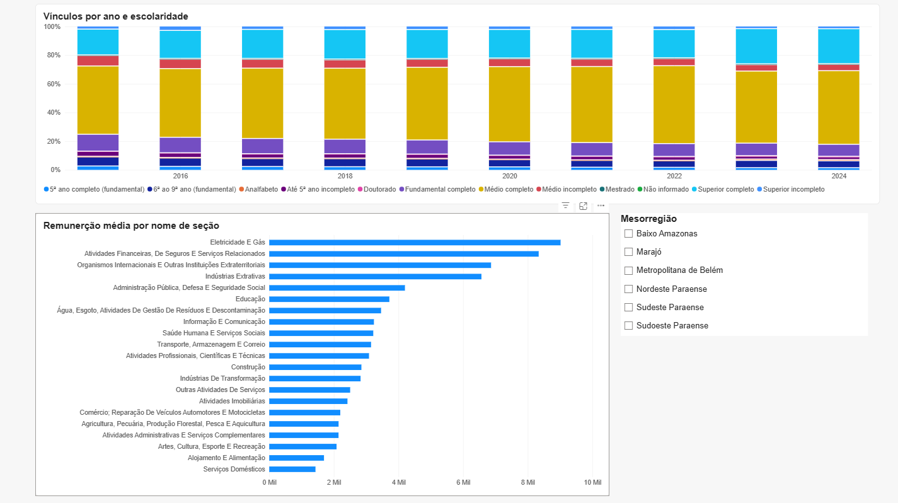
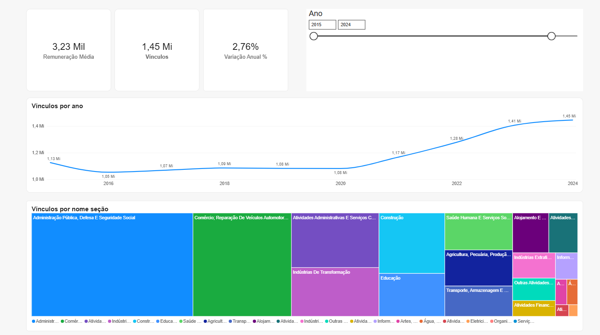

# Emprego formal no Pará (RAIS) — pipeline de dados com dbt, BigQuery e Power BI

Projeto de Analytics Engineering: do dado bruto público até um dashboard, com modelagem dimensional, testes e documentação.

> **Pergunta guia:** como evoluiu o emprego formal nos municípios do Pará na última década, por setor (CNAE) e escolaridade, e onde o agro gerou mais vagas formais?

## Dashboard

| Visão geral | Setor e escolaridade | Agro no Pará |
|---|---|---|
|  |  |  |

O arquivo do dashboard está em [`dashboard/rais_para.pbix`](dashboard/rais_para.pbix) (abre no Power BI Desktop, gratuito). As medidas DAX estão documentadas em [`docs/medidas_dax.md`](docs/medidas_dax.md).

## Principais achados

- **O emprego formal no Pará cresceu de 1,13 mi (2015) para 1,45 mi (2024) vínculos**, com queda em 2016 (1,05 mi) e variação de +2,76% em 2024 sobre 2023. Remuneração média de dezembro de 2024: cerca de R$ 3,23 mil (valores nominais).
- **A escolaridade mais comum é o ensino médio completo, e o ensino superior completo vem ganhando espaço.**
- **O agro tem 63 mil vínculos formais em 2024** (eram cerca de 53 mil em 2015), enquanto o valor da produção agrícola (lavouras) foi de cerca de R$ 10 bi para R$ 36 bi. Ou seja, o valor cresceu muito mais do que o emprego com carteira assinada.
- **Maiores ganhos de vagas formais no agro entre 2015 e 2024:** Santa Isabel do Pará (+2.325), Paragominas (+1.004), Santana do Araguaia (+714), Santa Maria das Barreiras (+696) e Garrafão do Norte (+616).
- **Produção alta não significa emprego formal alto.** Igarapé-Miri (açaí, R$ 13,9 bi acumulados 2015–2024) tinha só 60 vínculos agro em 2024, e Medicilândia (cacau, R$ 8,6 bi) 111. Já Paragominas (R$ 11,1 bi) tinha 3.960 e Dom Eliseu (R$ 6,7 bi) 1.263. O agro que gera vaga formal é o de grãos e pecuária; açaí e cacau são, em boa parte, agricultura familiar e extrativismo, com pouco registro formal.

## Arquitetura

```
Base dos Dados (BigQuery público)          dbt (BigQuery)                         Power BI
 br_me_rais.microdados_vinculos  ─┐   staging (views)      marts (tabelas)
 br_bd_diretorios_brasil         ─┼─► stg_rais_vinculos ─► fct_vinculos ──────┐
 br_ibge_pam (lavouras)          ─┘   stg_municipio     ─► dim_municipio      ├─► modo Import
                                      stg_cnae          ─► dim_cnae           │   (relações
                                      stg_pam_lavoura   ─► fct_agro_municipio_ano   dimensão → fato)
                                                           dim_escolaridade, dim_tempo
```

### Modelo estrela

- `fct_vinculos`: ano × município × classe CNAE × escolaridade (~420 mil linhas). Só vínculos ativos em 31/12.
- `fct_agro_municipio_ano`: ano × município, com vínculos agro (CNAE divisões 01, 02 e 03) e produção agrícola (PAM/IBGE).
- Dimensões: `dim_municipio` (144), `dim_cnae` (672), `dim_escolaridade` (12), `dim_tempo` (2015–2025).

### Testes

24 testes de dados (`not_null`, `unique`, `relationships` e testes singulares de granularidade única, em `rais_para/tests/`). Staging não tem testes de propósito: testar uma view releria a tabela fonte de 478 GB.

## Como rodar

Pré-requisitos: Python 3.12, [Google Cloud SDK](https://cloud.google.com/sdk) e uma conta Google com um projeto no BigQuery (o **sandbox gratuito** basta, sem cartão).

```bash
python -m venv .venv
.venv/Scripts/activate            # Windows (Linux/Mac: source .venv/bin/activate)
pip install -r requirements.txt

gcloud auth application-default login
```

Edite `rais_para/profiles.yml` e troque `project:` pelo ID do seu projeto. O login é via OAuth do gcloud, então não há senha nem chave no repositório.

```bash
cd rais_para
dbt run  --profiles-dir .
dbt test --profiles-dir .
dbt docs generate --profiles-dir . && dbt docs serve --profiles-dir .
```

## Decisões para ficar 100% no plano gratuito

- **BigQuery sandbox:** 10 GB de armazenamento e 1 TB de consultas por mês, sem cobrança.
- **Trava de custo:** `maximum_bytes_billed` de 10 GB no `profiles.yml`; o dbt recusa qualquer consulta que leia mais que isso.
- **Filtro sempre por `sigla_uf = 'PA'`** na tabela da RAIS, e `dry run` antes de consultas grandes.
- **Staging como view, marts como tabela:** views não ocupam espaço nem expiram.
- **Power BI em modo Import** (não DirectQuery), para não consumir cota do BigQuery a cada clique. O arquivo é aberto no Power BI Desktop; não foi publicado no Power BI Service, que exige licença paga.

## Atenção: tabelas do sandbox expiram em 60 dias

No sandbox, as **tabelas** (os marts) são apagadas automaticamente após 60 dias. As views não expiram. Para recriar tudo, basta rodar `dbt run --profiles-dir .` de novo (leva poucos minutos e fica dentro da cota gratuita).

## Limitações

- **Vínculos são um estoque (foto em 31/12), não um fluxo.** Não são somados entre anos: as medidas usam o último ano do filtro. Não mostram admissões e demissões.
- **Salários em reais nominais** (sem correção pela inflação), então comparações entre anos superestimam o ganho real.
- **A produção (PAM/IBGE) vai só até 2024 e cobre apenas lavouras** (temporária e permanente). Pecuária, extrativismo e silvicultura ficam de fora. Por isso o dashboard mostra 2015–2024; o 2025 existe na RAIS mas foi excluído dos filtros.
- **"Agro" na RAIS** = CNAE divisões 01 (agricultura e pecuária), 02 (silvicultura) e 03 (pesca e aquicultura).
- A RAIS cobre apenas emprego **formal**; a informalidade, importante no agro paraense, não aparece.

## Fontes

- [Base dos Dados](https://basedosdados.org): `br_me_rais`, `br_ibge_pam`, `br_bd_diretorios_brasil`.
- RAIS: Ministério do Trabalho e Emprego. PAM: IBGE.

## Estrutura do repositório

```
rais_para/        projeto dbt (models/staging, models/marts, tests)
dashboard/        arquivo do Power BI
docs/             medidas DAX e imagens do dashboard
requirements.txt  versões do dbt
```
